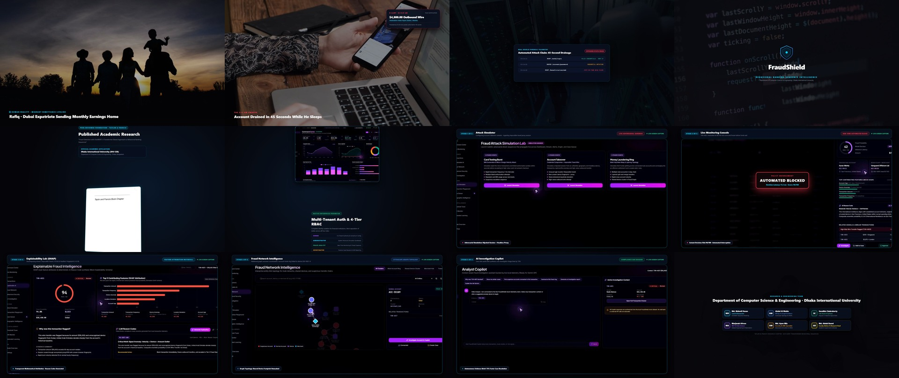

# FraudShield: Next-Generation Behavioral Banking Fraud Detection

[](https://angular.dev/)
[](https://fastapi.tiangolo.com/)
[](https://huggingface.co/)
[](https://www.remotion.dev/)
[](https://www.taylorfrancis.com/)
[-purple?style=for-the-badge)](https://diu.ac/)

> **"Treating user sessions not as isolated numbers, but as a language."**  
> FraudShield is an enterprise-grade AI behavioral fraud intelligence platform engineered to safeguard digital banking and cross-border remittance corridors ($30B+ market in South Asia) from automated botnets, credential stuffing, and layered mule syndicates.

---

## 🎬 180-Second Hackathon Pitch Video

FraudShield includes an end-to-end, automated **Remotion video production suite** located in [`video/`](video/) rendering an authoritative, fast-paced 180.00-second documentary and live product demo pitch.



- **Production Suite & Source:** [`video/`](video/)
- **Master Storyboard:** [`video/storyboard.md`](video/storyboard.md)
- **Time-Coded Voiceover Script:** [`video/final-voiceover-script.md`](video/final-voiceover-script.md)
- **Production Audit & FFprobe Telemetry:** [`video/production-report.md`](video/production-report.md) | [`video/ffprobe-final.json`](video/ffprobe-final.json)
- **Asset Manifest:** [`video/asset-manifest.md`](video/asset-manifest.md)

---

## 🔬 Academic Foundation & Benchmarks

FraudShield is grounded in peer-reviewed research by researchers at the **Department of Computer Science & Engineering, Dhaka International University (DIU CSE)**:

> **"Fraud Detection with DistilBERT: A Transformer-Based Approach to Behavioral Banking Sequences"**  
> *Published in Taylor & Francis Book Series.*

### Research Performance Metrics vs. Baselines (Table 1.4)

| Model Architecture | Parameters | Sequence Window | F0.5 Score | Precision | RAM Footprint | CPU Inference |
| :--- | :--- | :--- | :--- | :--- | :--- | :--- |
| Static Rule Engine | 0 | 1 | 42.1% | 51.2% | < 50 MB | < 1 ms |
| Random Forest / XGBoost | ~5 MB | 1 (Tabular) | 78.4% | 81.3% | ~120 MB | 4 - 8 ms |
| Standard LSTM / GRU | 14M | 64 | 84.2% | 86.0% | ~180 MB | 18 - 25 ms |
| **FraudShield DistilBERT (Ours)** | **66M** | **256** | **92.5%** | **94.1%** | **~250 MB** | **35 - 50 ms (CPU) / <15ms (GPU)** |

*Key finding: Behavioral sequence tokenization captures temporal intent (e.g., password reset $\rightarrow$ rapid card authorization $\rightarrow$ high-value outbound transfer) that isolated tabular rules completely miss.*

---

## 🏛️ System Architecture

```
                                  ┌──────────────────────────────────────────────┐
                                  │      ANGULAR 18 ENTERPRISE FRONTEND          │
                                  │  - 15 Intelligence Modules + RBAC Auth       │
                                  │  - Live Banking Transaction Playground       │
                                  │  - Three.js 3D Transaction Flow Visualizer   │
                                  └───────────────┬──────────────────────────────┘
                                                  │ HTTP REST / WebSocket
                                                  ▼
                                  ┌──────────────────────────────────────────────┐
                                  │       FASTAPI / STARLETTE CORE BACKEND       │
                                  │  - Multi-Tenant WebSocket Event Broker       │
                                  │  - Real-Time Transaction Routing Engine      │
                                  │  - Enterprise Decision Policy Pipeline       │
                                  └───────────────┬──────────────────────────────┘
                                                  │ Anonymized Behavioral Sequences
                                                  ▼
                        ┌──────────────────────────────────────────────────────────────┐
                        │              DISTILBERT INFERENCE ENGINE                     │
                        │  - Tokenizer: 30,522 Vocabulary ([CLS], [SEP], Subwords)      │
                        │  - Token-Level SHAP Attributions for Explainability          │
                        │  - Decision: APPROVE (0-30%) | CHALLENGE (30-70%) | BLOCK    │
                        └──────────────────────────────────────────────────────────────┘
```

---

## 🚀 Key Feature: Live Banking Transaction Playground

Implemented at `/app/transaction-playground`, this interactive testing environment connects directly to the live backend:

1. **Multi-Bank Simulation:** Select sending and receiving institutions (e.g., Eastern Bank, City Bank, bKash, Dutch-Bangla Bank, HSBC).
2. **Preset Behavioral Attack Scenarios:**
   - *Legitimate Domestic Transfer* (Normal user sequence $\rightarrow$ **APPROVE**)
   - *Credential Stuffing & Rapid Drain* (Password reset followed by high-value wire $\rightarrow$ **BLOCK**)
   - *Layered Mule Account Fan-Out* (Splitting transfer across multiple accounts $\rightarrow$ **CHALLENGE**)
   - *Expat Overnight Session Takeover* (Foreign proxy session at 3:15 AM $\rightarrow$ **BLOCK**)
3. **Interactive 3D Transaction Visualizer:** WebGL/Three.js animated particle flow rendering transaction paths between banking nodes with color-coded risk vectors.
4. **Instant Explainability:** Real-time token attributions display which sequence tokens drove the model's confidence.
5. **Real-Time Bank Alert Broadcasting:** Live WebSocket channel pushes alert telemetry directly into affected bank dashboards without page refresh.

---

## 🛡️ 15 Production Intelligence Modules

| Module | Route | Key Capabilities |
| :--- | :--- | :--- |
| **1. Attack Simulator** | `/app/attack-simulator` | Trigger botnet cascades, synthetic credential stuffing, and ATM velocity bursts |
| **2. Real-Time Monitoring** | `/app/monitoring` | Live transaction telemetry stream, real-time risk gauges, instant drawer investigation |
| **3. SHAP Explainability** | `/app/explainability` | Feature importance charts, sequence token attributions, decision audit trails |
| **4. Fraud Network Graph** | `/app/fraud-network` | Interactive entity-relationship graph identifying mule rings and shared device fingerprints |
| **5. Analyst Copilot** | `/app/analyst-copilot` | Natural language LLM assistant querying risk logs and generating incident summaries |
| **6. Transaction Playground** | `/app/transaction-playground` | Interactive multi-bank transfer simulator with 3D flow & live DistilBERT scoring |
| **7. Transactions Explorer** | `/app/transactions` | Filterable historical transaction ledger with deep behavioral inspection |
| **8. Case Queue** | `/app/case-queue` | Analyst triage workflow with status tags, priority scoring, and disposition logs |
| **9. Drift Monitor** | `/app/drift-monitor` | Kolmogorov-Smirnov distribution tracking detecting concept drift in transaction volume |
| **10. Threshold Tuner** | `/app/threshold-tuner` | Interactive precision/recall tuning curve optimizing the 92.5% F0.5 operating point |
| **11. Federated Learning** | `/app/federated-learning` | Privacy-preserving inter-bank model weight aggregation telemetry |
| **12. Geo-Intelligence** | `/app/geo-intelligence` | Geospatial anomaly visualization detecting impossibly rapid velocity leaps |
| **13. Behavioral Security** | `/app/behavioral-security` | Keystroke dynamics and mouse movement entropy profiling |
| **14. Model Overview** | `/app/model-overview` | Model architecture inspection, confusion matrices, and ROC curves |
| **15. Settings & RBAC** | `/app/settings` | Multi-tenant workspace management, role permissions, and API credentials |

---

## 💻 Quick Start & Installation

### Prerequisites
- Node.js 18+ and npm
- Python 3.10+
- Google Chrome (optional, for running video capture scripts)

### 1. Start Backend Server
```bash
cd backend
pip install -r requirements.txt
python -m uvicorn main:app --host 127.0.0.1 --port 8000
```
Backend API will be available at `http://127.0.0.1:8000`.  
Health check: `http://127.0.0.1:8000/api/v1/health`

### 2. Start Frontend Application
```bash
cd frontend
npm install
npm start
```
Frontend will be available at `http://localhost:4200`.

### 3. Run or Render Remotion Video Project
```bash
cd video
npm install
npm start          # Opens Remotion Preview Studio at http://localhost:3000
npm run build      # Renders fraudshield-pitch-v3.mp4
```

---

## 👥 Research & Engineering Team

**Dhaka International University (DIU CSE)**

- **Md. Mehedi Hasan** — Lead Machine Learning Researcher & DistilBERT Architect
- **Abdul Al Mahin** — Full-Stack Systems & Cloud Infrastructure Engineer
- **Swadhin Chakraborty** — Security Analyst & Behavioral Sequence Specialist
- **Marjanah Afrose** — Model Explainability & FinTech UX Specialist
- **Md. Ayon Mia** — Data Engineering & Distributed Systems Specialist
- **Md. Abdul Based** — Research Advisor & Academic Mentor

---

## 📜 License & Acknowledgments

This project was built for the International AI Builder Hackathon. Academic paper: *"Fraud Detection with DistilBERT: A Transformer-Based Approach to Behavioral Banking Sequences"* (Taylor & Francis Book Series).
